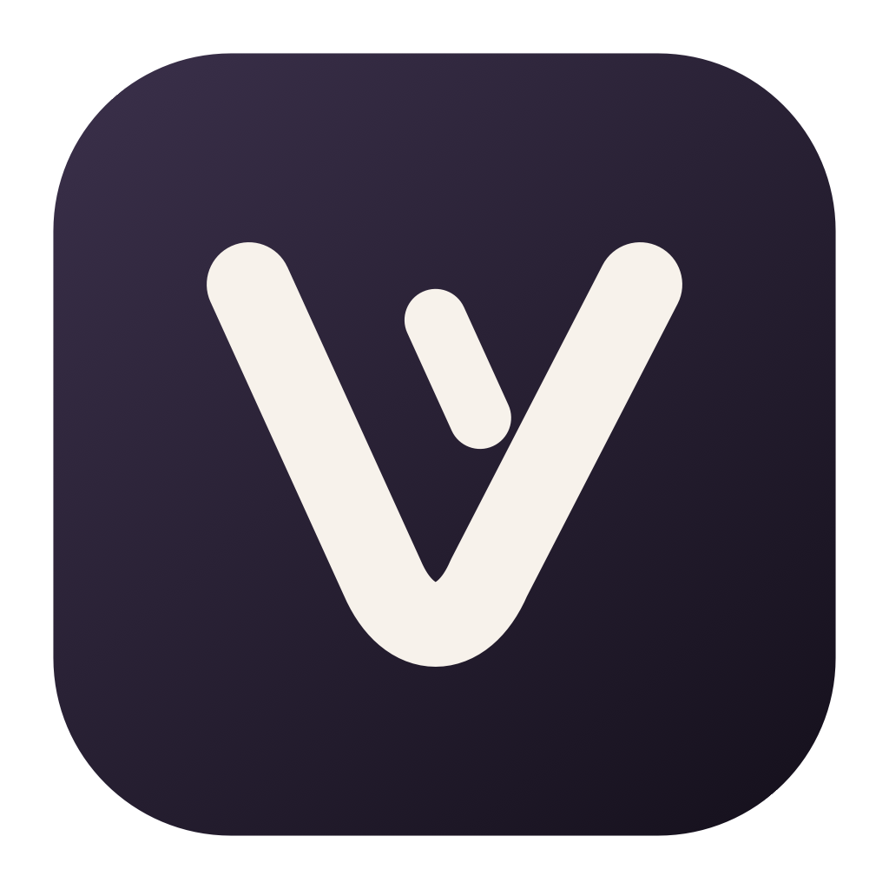

# Voxlume

Voxlume is a native macOS voice dictation app. Hold Fn to speak, or double-tap Fn for hands-free recording. It includes a floating audio-responsive recording bar, writing styles, a personal dictionary, snippets, dictation history, and meeting notes.

## Download

A public Mac download is being prepared. It will appear under this repository's **Releases** after the app is signed and notarized for distribution. There is no downloadable release yet.

## Requirements

- An Apple silicon Mac running macOS 26 or later for the current build.
- Microphone access for dictation.
- Accessibility and Input Monitoring access for the Fn shortcut and inserting text into other apps.
- Screen and system audio recording access only if you use meeting capture.
- Your own API key for any selected paid cloud speech or text provider. Provider charges may apply. Voxlume also has local speech options.

## Privacy and source code

Voxlume stores app settings and history locally and keeps configured API keys in macOS Keychain. When a cloud provider is selected, the app sends the audio or text needed for that feature to that provider. Do not dictate sensitive information through a provider you do not trust.

This GitHub repository is for downloads, documentation, and issue reports. Voxlume's application source code and formatting rules are private. **Free to use does not mean open source.**

The app includes components licensed by their respective authors. Their notices are included with the download.

## Feedback

Use this repository's Issues tab to report bugs. Include your macOS version, the recording mode you used, and the expected and actual result. Never post API keys, private dictation text, or meeting recordings in an issue.
